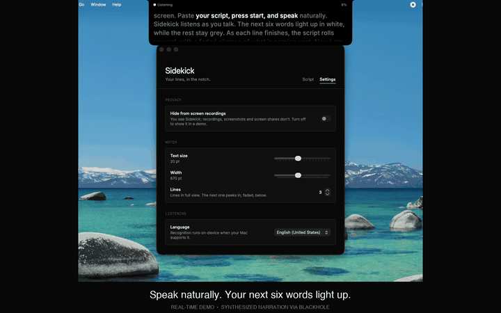

# Sidekick

[](https://github.com/therealharpaljadeja/sidekick/actions/workflows/ci.yml)
[](https://github.com/therealharpaljadeja/sidekick/releases/latest)

A teleprompter that lives in your MacBook notch. Paste your script, hit **⌥⌘P**, and talk. Sidekick listens, highlights the next words you need to say, and rolls the script up line by line like movie credits, right under the camera. It hides itself from screen recordings, screenshots and screen sharing, so your viewers never see it.

> [!WARNING]
> Sidekick is vibe coded: it was built quickly with AI and has not been reviewed or tested the way production software is. Use it at your own risk.

## Demo

[](docs/demo.mp4)

[Watch the full 1-minute demo with sound](docs/demo.mp4): Sidekick follows the narration, hides from the recording mid-script and comes back. Recorded with a ScreenCaptureKit recorder and a synthesized voice.

## Install

Download the latest `Sidekick-<version>.dmg` from [Releases](https://github.com/therealharpaljadeja/sidekick/releases/latest), open it and drag **Sidekick** into **Applications**. Builds without an Apple Developer ID signature are blocked on first launch; allow it in **System Settings → Privacy & Security → Open Anyway**, or run:

```bash
xattr -dr com.apple.quarantine /Applications/Sidekick.app
```

If speech recognition reports "Siri and Dictation are disabled", turn on Dictation in **System Settings → Keyboard**.

## Requirements

- macOS 13 Ventura or later (best on a MacBook with a notch; on other displays it hangs from the top centre of the screen)
- Xcode 15+ or the Swift 5.9+ command line tools

## Build and run

```bash
git clone https://github.com/therealharpaljadeja/sidekick.git
cd sidekick
./Scripts/build-app.sh --install   # builds build/Sidekick.app, copies it to /Applications, launches it
```

On first start, macOS asks for **Microphone** and **Speech Recognition** access. Click the Dock icon to reopen the window after closing it.

## Share a DMG

```bash
./Scripts/make-dmg.sh   # universal (Apple Silicon + Intel) build/Sidekick-<version>.dmg
```

Unsigned DMGs trigger a Gatekeeper warning on other Macs. To avoid it, sign and notarize with an Apple Developer ID:

```bash
xcrun notarytool store-credentials sidekick --apple-id you@example.com --team-id TEAMID
SIGN_IDENTITY="Developer ID Application: Your Name (TEAMID)" NOTARY_PROFILE=sidekick ./Scripts/make-dmg.sh
```

## Using it

1. Paste your script into the **Script** tab.
2. Click **Start in notch** (or press ⌥⌘P from anywhere).
3. Read. The next six words are white and everything else is grey, including the words you've already said. When you finish a line it rolls up and the next one slides in; the faded line at the bottom shows there's more coming.

| Shortcut | Action |
|---|---|
| ⌥⌘P | Start · pause · resume |
| ⌥⌘R | Restart from the top |
| ⌥⌘← / ⌥⌘→ | Previous / next sentence |
| ⌥⌘. | Stop and hide |
| ⌃⌥⌘H | Hide · show in recordings (change it in **Settings → Shortcuts**) |

Click the notch to pause or resume; scroll over it to nudge word by word. **Settings** has text size, panel width, number of lines and speech language.

## Hiding from recordings

With **Settings → Hide from screen recordings** on (the default), every Sidekick window uses `NSWindow.sharingType = .none`. macOS leaves those windows out of screenshots, screen recordings and screen sharing while still drawing them on your display — no cropping. Turn the toggle off (or press ⌃⌥⌘H) when you want Sidekick to appear in a demo. The light in the top-right of the notch shows the current state: a hollow ring means **Hidden**, a glowing dot means **In recordings**.

QuickTime, the screenshot toolbar, `screencapture`, OBS and Zoom/Meet/Teams use ScreenCaptureKit and respect it. Tools built on the legacy AVFoundation `AVCaptureScreenInput` or `CGDisplayStream` APIs (e.g. ffmpeg's `avfoundation` input) ignore it on macOS 26, so check once with the recorder you actually use.

## How it follows you

Audio goes to Apple's Speech framework (on-device when supported, so nothing leaves your Mac). Each recognized word is matched against the next few script words with fuzzy matching, so filler words, small misrecognitions and dropped words don't derail it. Common words like "the" can't jump ahead on their own, and three matching words in a row can re-sync up to 40 words ahead if you skip a sentence. Pauses are fine: when macOS starts a new transcript after you stop talking, Sidekick picks up from where you left off.

The matching logic lives in `Sources/SidekickCore` and is covered by `swift test`.

## Contributing

See [CONTRIBUTING.md](CONTRIBUTING.md) for building, pull requests and how releases are cut, and [CHANGELOG.md](CHANGELOG.md) for what changed in each version. Report security issues privately as described in [SECURITY.md](SECURITY.md).

## Credits

Type is [Intern](https://github.com/bvvst/intern), a rounded Inter by bvvst, under the SIL Open Font License (`Resources/Fonts/OFL.txt`).

## License

[MIT](LICENSE). The bundled Intern font is under its own [SIL Open Font License](Resources/Fonts/OFL.txt).
